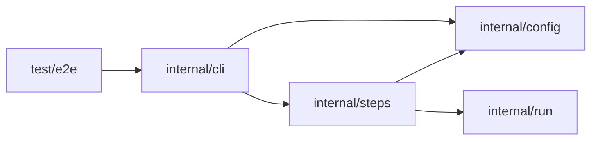
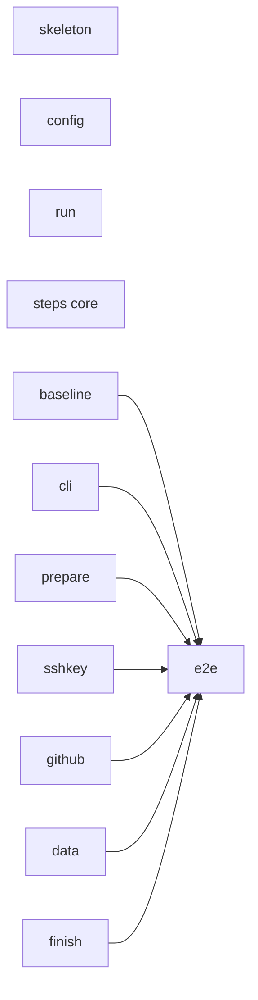

# athome binary, build 1: `init --config` beside the bash

**Goal:** a Go `athome` binary whose `init` does what `scripts/bootstrap.sh` does, proven by the unchanged e2e verify scripts.
**Architecture:** config loads answers, run wraps external tools (faked in tests), steps is an ordered {name, check, apply} list, cli wires it.
**Tech stack:** Go 1.27, stdlib, `github.com/BurntSushi/toml`. Test: `go test ./...`.
**Spec:** docs/superpowers/specs/2026-11-16-athome-binary-design.md, section "Build 1".
**Detail:** contracts
**Target-min:** 14

Spec coverage: build 1 covers "Build 1: `init --config` beside the bash (migration step 1)", "Layout", "Testing" and the `init` part of "Commands" and "Three ways to run it". Later builds of this spec: "What happens to the bash", "Versioning and self-update", "Release hosting" (step 2); "The init form" (step 3); "Updating the rest of termage" (step 4). Context only: "Problem", "Decision", "Migration".

Global constraints:
- Module `github.com/morrieinmaas/athome`; `go.mod` says `go 1.27`. Repo `mise.toml` pins `go = "1.27"`.
- Behaviour source of truth: `scripts/bootstrap.sh`, `scripts/lib/*.sh` on origin/main. Each step's doc comment names the bash line range it ports.
- No prompts in build 1: anything bash would ask takes the `--non-interactive` answer.
- External tools only through `run.Runner`; no step calls `os/exec` directly. Tests never touch the real `$HOME`: every test uses `t.TempDir()` as home.
- Never modify `scripts/bootstrap.sh`, `scripts/teardown.sh` or the verify scripts.

## File structure

- `go.mod`, `go.sum`, `cmd/athome/main.go`: module and entry point (calls `cli.Main`).
- `internal/config/config.go`: `Config`, `Load`, validation.
- `internal/run/run.go`: `Runner`, `Exec`, `Fake`.
- `internal/steps/steps.go`: `Step`, `Env`, `Execute`, `All`.
- `internal/steps/prepare.go`: repo check, chezmoi symlink, ref worktree, sudo cache, chezmoi install.
- `internal/steps/sshkey.go`: key import (dir, Bitwarden), generation, Bitwarden copy.
- `internal/steps/github.go`: key and signing-key upload, ssh config seed, remote to ssh.
- `internal/steps/data.go`: identity, chezmoi `[data]`.
- `internal/steps/baseline.go`: `chezmoi init --apply`, baseline packages, project dirs, mise.
- `internal/steps/finish.go`: sourceDir pin, git hooks, Bitwarden setup, secrets restore, detached HEAD.
- `internal/cli/cli.go`: `init`, `version`, help, exit codes.
- `test/e2e/*`: Dockerfiles build the binary; `scenario.sh` picks the runner; CI matrix.

```mermaid
%% schedule
gantt
  title Predicted schedule (mm:ss)
  dateFormat X
  axisFormat %M:%S
  section lane 1
  T8 finish steps and order :t8, 0, 434s
  T10 e2e :t10, 434, 346s
  section lane 2
  T6 github steps :t6, 0, 364s
  section lane 3
  T4 prepare steps :t4, 0, 352s
  section lane 4
  T5 ssh key steps :t5, 0, 352s
  section lane 5
  T1 config :t1, 0, 330s
  section lane 6
  T9 cli :t9, 0, 307s
  section lane 7
  T3 steps core :t3, 0, 273s
  section lane 8
  T2 run :t2, 0, 262s
  section lane 9
  T11 chezmoi and baseline :t11, 0, 262s
  section lane 10
  T7 identity and data :t7, 0, 251s
  T0 skeleton :t0, 251, 128s
```

critical path: T8 → T10 (13.0 min) · peak width 10 · predicted build 13.0 min · predicted total ≈ 16.5 min (target ✗ 14.0)

## Package internal (library)

**Probe entry:** call=internal/config.Load · run=go run ./cmd/athome

### T0 skeleton · Complexity 1 · Est. context 22k
**Kind:** mechanical
**Model:** haiku
**Owns:** go.mod, go.sum, cmd/athome/main.go, mise.toml
**Components:** 1
**LOC owned:** 40
**Tests:** fast
**Produces:** none beyond the module; `cmd/athome/main.go` is `func main() { os.Exit(cli.Main(os.Args[1:], os.Stdout, os.Stderr)) }`.
**Test code:** `go build ./...` succeeds; `go vet ./...` clean.
**Steps:** create files, add `go = "1.27"` under mise.toml `[tools]`, `go mod tidy`.

### T1 config · Complexity 4 · Est. context 34k
**Owns:** internal/config/config.go, internal/config/config_test.go, internal/config/testdata/*
**Components:** 1
**LOC owned:** 200
**Tests:** fast
**Model:** sonnet
**Produces:** config.Load(o config.Options) (config.Config, error) · config.Options{ConfigPath string; RepoRoot string; Home string; Env map[string]string; Machine string; NoAgents bool} · config.Config{Machine string; IncludeAgents bool; Data map[string]string; Source string} · config.ErrUsage (exit 2 errors wrap it)
e.g. Load(Options{ConfigPath:"test/e2e/bootstrap.toml"}) -> Config{Machine:"personal", IncludeAgents:false, Data:{"githubHandle":"athome-ci","githubId":"0","personalName":"athome ci",...}}
e.g. Load(Options{Env:{"ATHOME_GITHUB_HANDLE":"x"}, ConfigPath:f with githubHandle="y"}) -> Data["githubHandle"]=="x"
e.g. Load(Options{Machine:"laptop"}) -> error wrapping ErrUsage, message contains "laptop"
**Review Focus:** `TestPrecedence` flag > env > file > default for every key in the bash table (B:189-215); `TestDiscovery` three files present picks `--config`; `TestQuotedHash` `a = "x=y # z"` gives `x=y # z`; `TestEmptyFile` gives defaults (meshProvider "meshnet", machine "personal", includeAgents true); `TestBadValues` machine "laptop" and includeAgents "maybe" wrap ErrUsage.
**Notes:** key list and env names are the bash table verbatim.

### T2 run · Complexity 3 · Est. context 28k
**Owns:** internal/run/run.go, internal/run/run_test.go
**Components:** 1
**LOC owned:** 140
**Tests:** fast
**Model:** sonnet
**Produces:** run.Cmd{Name string; Args []string; Dir string; Env []string; Stdin string} · run.Result{Stdout string; Stderr string; Code int} · run.Runner interface{ Run(ctx context.Context, c run.Cmd) (run.Result, error); LookPath(name string) (string, error) } · run.Exec() run.Runner · run.NewFake() *run.Fake with Fake.On(name string, args ...string) *run.Fake, Fake.Return(r run.Result), Fake.Calls() []run.Cmd, Fake.Have(names ...string)
e.g. f := NewFake(); f.On("gh","api","user").Return(Result{Stdout:`{"login":"a"}`}); f.Run(ctx, Cmd{Name:"gh",Args:["api","user"]}) -> Result{Stdout:`{"login":"a"}`}, nil
e.g. unmatched call on Fake -> Result{Code:0}, nil, recorded in Calls()**Review Focus:** `TestExecNonZero` `false` gives Code 1, nil error; `TestExecMissing` unknown binary errors; `TestFakeRecords` Calls in order.

### T3 steps core · Complexity 4 · Est. context 30k
**Owns:** internal/steps/steps.go, internal/steps/steps_test.go
**Components:** 1
**LOC owned:** 150
**Tests:** fast
**Model:** sonnet
**Produces:** steps.Step{Name string; Check func(context.Context, *steps.Env) (bool, error); Apply func(context.Context, *steps.Env) error} · steps.Env{Cfg config.Config; Run run.Runner; Home string; RepoRoot string; OS string; Distro string; Opts steps.Opts; Log io.Writer; Warnings int} · steps.Opts{Ref string; ImportFrom string; ImportSSH bool; ImportSSHBW string; CI bool} · steps.Execute(ctx context.Context, env *steps.Env, list []steps.Step) (steps.Report, error) · steps.Report{Applied []string; Skipped []string}
e.g. Execute with [a(check true), b(check false)] -> Report{Skipped:["a"], Applied:["b"]}, nil
e.g. Execute with b.Apply returning errX -> error containing "b" wrapping errX, Report.Applied excludes b and later steps
**Review Focus:** `TestSkipDone`, `TestStopOnError` names the step, `TestResume` rerun after a failure skips earlier steps, `TestIdempotent` second run applies nothing.
**Notes:** no progress file; resume comes from checks.

### T4 prepare steps · Complexity 4 · Est. context 36k
**Owns:** internal/steps/prepare.go, internal/steps/prepare_test.go
**Components:** 1
**LOC owned:** 220
**Tests:** fast
**Model:** sonnet
**Consumes:** steps.Step, steps.Env (T3) · run.Runner, run.NewFake (T2) · config.Config (T1)
**Produces:** steps.Prepare() []steps.Step
**Review Focus:** `TestRepoCheck` missing `.chezmoiroot` fails with a message (B:155-167); `TestSymlinkExisting` a link already pointing at the repo skips, a real directory at `~/.local/share/chezmoi` fails without deleting it; `TestRefWorktree` a ref different from HEAD records `git worktree add --detach` (B:267-324); `TestChezmoiInstall` skipped when LookPath finds chezmoi.
**Notes:** sudo cache (B:332-338): background `sudo -n true` every 60 s until init returns.

### T5 ssh key steps · Complexity 5 · Est. context 36k
**Owns:** internal/steps/sshkey.go, internal/steps/sshkey_test.go
**Components:** 1
**LOC owned:** 220
**Tests:** fast
**Model:** sonnet
**Consumes:** steps.Step, steps.Env (T3) · run.Runner (T2)
**Produces:** steps.SSHKey() []steps.Step
**Review Focus:** `TestImportDir` copies the first `ssh/*_ed25519` with mode 0600 and derives `.pub` with `ssh-keygen -y` (B:363-388); `TestImportSkipsExisting`; `TestImportBW` records `rbw get --field notes <item>` (B:395-412); `TestGenerate` no key and non-interactive with generateSshKey true records `ssh-keygen -t ed25519 -N ""` at `~/.ssh/<host>_ed25519`; `TestKeyNoPub` existing key without `.pub` regenerates `.pub`; `TestBWCopyOnlyFresh` Bitwarden copy only after a fresh generate (B:464-496).
**Notes:** key name uses chezmoi's hostname (B:352-354).

### T6 github steps · Complexity 5 · Est. context 38k
**Owns:** internal/steps/github.go, internal/steps/github_test.go
**Components:** 1
**LOC owned:** 230
**Tests:** fast
**Model:** sonnet
**Consumes:** steps.Step, steps.Env (T3) · run.Runner (T2)
**Produces:** steps.GitHub() []steps.Step
**Review Focus:** `TestCISkipsUpload` Opts.CI records no `gh ssh-key add`; `TestAlreadyRegistered` a local pub in `gh api user/keys` records only the signing-key check (B:498-756); `TestNoGh` gh missing or unauthenticated skips with a log line, no error; `TestSeed` appends the github.com block only when the key basename is absent from `~/.ssh/config` (lib/ssh.sh:13-27); `TestRemoteToSSH` https origin becomes `git@github.com:`.
**Notes:** GITHUB_TOKEN set or a failed refresh: print manual-upload instructions, never fail.

### T7 identity and data · Complexity 4 · Est. context 34k
**Owns:** internal/steps/data.go, internal/steps/data_test.go, internal/steps/testdata/chezmoi-data.golden.toml
**Components:** 1
**LOC owned:** 130
**Tests:** fast
**Model:** sonnet
**Consumes:** steps.Step, steps.Env (T3) · run.Runner (T2) · config.Config (T1)
**Produces:** steps.Data() []steps.Step
**Review Focus:** `TestDataGolden` the e2e toml writes `[data]` equal to a golden captured from `bootstrap.sh` (B:875-900; capture command in the test); `TestIdentity` handle from env, then `gh api user`; id from `gh api users/<h>` (B:830-847).

### T11 chezmoi and baseline · Complexity 4 · Est. context 34k
**Owns:** internal/steps/baseline.go, internal/steps/baseline_test.go
**Components:** 1
**LOC owned:** 140
**Tests:** fast
**Model:** sonnet
**Consumes:** steps.Step, steps.Env (T3) · run.Runner (T2)
**Produces:** steps.Baseline() []steps.Step
**Review Focus:** `TestChezmoiApplyNonFatal` failing `chezmoi init --apply --force --exclude=scripts --source=<repo>/home` adds a warning, no error; `TestPackages` darwin `nb install gh rbw gitleaks`, fedora `sudo dnf install -y`, arch `yay -S --needed github-cli rbw gitleaks` (lib/pm.sh:8-23); `TestProjectDirs` personal: `~/personal`, `~/sidebiz`; work: `~/work`; an existing `.envrc` untouched.

### T8 finish steps and order · Complexity 4 · Est. context 36k
**Owns:** internal/steps/finish.go, internal/steps/finish_test.go, internal/steps/all.go, internal/steps/all_test.go
**Components:** 2
**LOC owned:** 200
**Tests:** fast
**Model:** sonnet
**Consumes:** steps.Step, steps.Env (T3) · steps.Prepare(), steps.SSHKey(), steps.GitHub(), steps.Data(), steps.Baseline() (names only)
**Produces:** steps.Finish() []steps.Step · steps.All() []steps.Step (Prepare, SSHKey, GitHub, Data, Baseline, Finish, in bash order)
e.g. names of steps.All() start with "repo-check" and end with "checkout-main"
**Review Focus:** `TestSourceDirPin` prepends `sourceDir` only when absent (B:958-964); `TestHooksSkipExisting` (B:969-974); `TestBitwardenNonInteractive` never runs `bw-setup` without a terminal, always creates `~/.secrets` (B:982-1008); `TestSecretsRestoreSkip` an existing `~/.secrets/*/.env` skips (B:1015-1030); `TestDetachedHead` records `git checkout main`, falling back to `checkout -B main origin/main`; `TestOrder` step names unique and in bash order.
**Notes:** all.go compiles against T4-T7 stubs; its order test uses names only.

## Package cli and e2e

**Probe entry:** run=go run ./cmd/athome

### T9 cli · Complexity 4 · Est. context 34k
**Owns:** internal/cli/cli.go, internal/cli/cli_test.go
**Components:** 1
**LOC owned:** 180
**Tests:** fast
**Model:** sonnet
**Consumes:** config.Load (T1) · steps.All, steps.Execute (T3, T8) · run.Exec (T2)
**Produces:** cli.Main(args []string, stdout, stderr io.Writer) int · cli.Version, cli.Commit (set by -ldflags)
e.g. Main(["version"]) -> 0, stdout "athome dev (none)\n"
e.g. Main(["init","--bogus"]) -> 2
**Review Focus:** `TestFlags` each of `--ref --machine --config --no-agents --import-from --import-ssh --import-ssh-bw --non-interactive -y --yes` sets its field; `TestUnknownFlag` exits 2; `TestUsageError` ErrUsage exits 2, other errors exit 1; `TestHelp` exits 0; `TestImportSSHAlone` `--import-ssh` without `--import-from` parses, prints a note and continues (bash parity).
**Notes:** stdlib `flag`; repo root: nearest `.chezmoiroot` upward from the cwd.

### T10 e2e · Complexity 4 · Est. context 32k
**Owns:** test/e2e/Dockerfile, test/e2e/Dockerfile.fedora, test/e2e/scenario.sh, .github/workflows/e2e.yml, .github/workflows/go.yml, docs/install.md
**Components:** 2
**LOC owned:** 90
**Tests:** slow
**Model:** sonnet
**Consumes:** cli.Main(args []string, stdout, stderr io.Writer) int (T9)
**Produces:** CI legs `bootstrap-<distro>-<runner>` for arch and fedora, runners bash and binary
**Review Focus:** `scenario.sh` with `ATHOME_E2E_RUNNER=binary` runs `athome init --config test/e2e/bootstrap.toml --machine personal` in both bootstrap phases, teardown stays `teardown.sh`; verify scripts byte-identical; go.yml runs `go vet ./...` and `go test ./...`.
**Notes:** Dockerfiles add a golang:1.27 build stage for `/usr/local/bin/athome`; docs/install.md gets an "athome binary (preview)" note.

## Review Focus

- internal (library): state, file, encoding. Risks: precedence drift, tests writing outside the temp home, mutating before the check, quoted `=`/`#`, paths with spaces.
- cli and e2e (CLI): protocol (flags, exit codes), state (resume), file (verify scripts unchanged).

## Self-review

Criteria 1-3 T1/T9, 4 T7, 5-7 T3, 8 T6, 9 T10, 10 T9. Edges only into T10, which runs real code.
