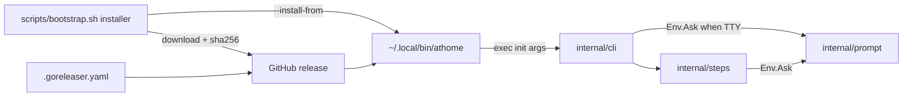
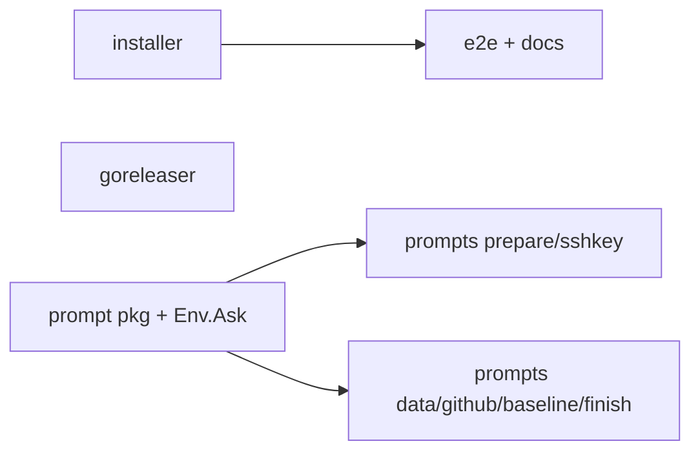

# athome binary build 2: installer, releases, plain prompts

**Goal:** `scripts/bootstrap.sh` installs a checksummed `athome` release and execs `athome init`; interactive `athome init` asks bash's nine questions.
**Architecture:** a small bash installer in front of the Go binary; GoReleaser for releases; an `internal/prompt` package used by the steps through `Env.Ask`.
**Tech stack:** bash + bats, Go 1.27 stdlib, GoReleaser v2.
**Spec:** docs/superpowers/specs/2026-11-16-athome-binary-design.md, section "Build 2".
**Detail:** tests
**Target-min:** 11

Spec coverage: build 2 covers "Build 2", "What happens to the bash" (installer part), "Release hosting", and the version part of "Versioning and self-update". Context only: everything else.

Global constraints:
- Go module `github.com/morrieinmaas/athome`, test command `go test ./...`, bats command `bats test`.
- Tests never touch the real home: temp `HOME`, temp `TMPDIR`, `TMUX`, `GROFE`, `ATHOME_CI`, `GITHUB_TOKEN` unset.
- Asset names `athome_<os>_<arch>`, `checksums.txt`; base `ATHOME_RELEASE_BASE`, default `https://github.com/morrieinmaas/athome/releases/download`.
- ldflags `-X github.com/morrieinmaas/athome/internal/cli.Version={{.Version}} -X github.com/morrieinmaas/athome/internal/cli.Commit={{.Commit}}`.
- Prompts go to stderr, answers from stdin; prompt wording and defaults copied from `scripts/bootstrap-legacy.sh` (lines 250, 428, 445, 633, 668, 837, 861, 990, 1025 of today's bootstrap.sh).
- Conventional commits, no AI attribution, no em dash.

## File structure

- `scripts/bootstrap.sh`: installer only.
- `scripts/bootstrap-legacy.sh`: today's bootstrap.sh, usage text renamed.
- `test/bootstrap.bats`: installer tests against a `file://` release dir.
- `.goreleaser.yaml`, `.github/workflows/release.yml`: release builds; `.github/workflows/go.yml`: adds `goreleaser check` + snapshot.
- `internal/prompt/prompt.go`, `prompt_test.go`: Asker over an io.Reader and io.Writer.
- `internal/steps/steps.go`: `Env.Ask` field; `internal/cli/cli.go`: sets it when interactive.
- Prompt sites: `internal/steps/prepare.go`, `sshkey.go` (T4); `data.go`, `github.go`, `baseline.go`, `finish.go` (T5).
- `test/e2e/scenario.sh`, `.github/workflows/e2e.yml`, `docs/install.md`, `README.md`, `docs/commands.md`.

## Task graph

```mermaid
%% schedule
gantt
  title Predicted schedule (mm:ss)
  dateFormat X
  axisFormat %M:%S
  section lane 1
  T3 prompt package and Env.Ask :t3, 0, 366s
  section lane 2
  T1 installer :t1, 0, 273s
  T6 e2e runner and docs :t6, 273, 368s
  section lane 3
  T5 prompts in data  github  baseline  fi :t5, 0, 262s
  section lane 4
  T4 prompts in prepare and sshkey :t4, 0, 239s
  section lane 5
  T2 goreleaser :t2, 0, 182s
```

critical path: T1 → T6 (10.7 min) · peak width 5 · predicted build 10.7 min · predicted total ≈ 14.2 min (target ✗ 11.0)

## Installer

**Probe entry:** run=bash scripts/bootstrap.sh
App type: CLI. Categories: protocol, file, state.

### T1 installer · Complexity 4 · Est. context 40k
**Owns:** scripts/bootstrap.sh, scripts/bootstrap-legacy.sh, test/bootstrap.bats
**Components:** 1
**LOC owned:** 150
**Tests:** fast
**Model:** sonnet
**Consumes:** none
**Produces:** bootstrap.sh [--install-from PATH] [init args...] -> exec athome init args
**Review Focus:** `checksum mismatch leaves no binary`: wrong hash in checksums.txt exits 1 and ~/.local/bin/athome does not exist; `install-from last arg`: `bootstrap.sh --install-from` exits 1; `path with spaces`: `--install-from "$T/a b/athome"` installs.
**Test code (verbatim):** named tests, exact outcomes: `installs from release and execs init` (stub athome prints `$@` to $T/args; run `bootstrap.sh --machine work -y`; args file is `init --machine work -y`; mode 0755); `checksum mismatch exits 1`; `missing asset exits 1` (message names the URL); `unsupported arch exits 1` (fake `uname` on PATH printing `riscv64`); `install-from skips download` (ATHOME_RELEASE_BASE=file:///nonexistent still succeeds); `install-from without path exits 1`; `wanted version already installed downloads nothing` (stub prints `athome v0.4.0 (abc)` for `version`, base unreachable, succeeds); `no tags exits 1 naming --install-from`; `ATHOME_VERSION overrides tag`; `--help prints usage` (exit 0, contains `--install-from`); `no sha256 tool exits 1` (PATH without sha256sum and shasum).
**Steps:** 1 `git mv scripts/bootstrap.sh scripts/bootstrap-legacy.sh`, fix its usage lines, 2 failing bats, 3 write installer (`set -euo pipefail`, curl -fsSL, download to a temp file in `~/.local/bin`, verify, `chmod 0755`, `mv`), 4 `bats test/bootstrap.bats` PASS, `shellcheck scripts/bootstrap.sh`.
**Notes:** tag from `git -C "$repo_root" describe --tags --exact-match HEAD`, else `--abbrev=0`. Version check: `athome version` first field after `athome`. sha256 via `sha256sum` else `shasum -a 256`. The repo is the script's `../`; tests copy the script into a temp git repo with a tag `v0.4.0`.

## Release

**Probe entry:** run=goreleaser check
App type: file I/O / generator. Categories: file.

### T2 goreleaser · Complexity 2 · Est. context 25k
**Owns:** .goreleaser.yaml, .github/workflows/release.yml, .github/workflows/go.yml
**Components:** 1
**LOC owned:** 70
**Tests:** slow
**Model:** sonnet
**Consumes:** none
**Produces:** release assets athome_<os>_<arch> + checksums.txt
**Review Focus:** `snapshot lists four binaries`: `goreleaser build --snapshot --clean` yields darwin/linux x amd64/arm64.
**Test code (verbatim):** go.yml job `release-check`: `goreleaser check`, then `goreleaser release --snapshot --clean --skip=publish`, then `test -f dist/checksums.txt` and `ls dist/athome_{darwin,linux}_{amd64,arm64}` (binary format `binary`, `name_template: athome_{{ .Os }}_{{ .Arch }}`, `no_unique_dist_dir: true`), then `dist/athome_linux_amd64 version | grep -q SNAPSHOT`.
**Steps:** 1 write config (version 2, `builds[0].main: ./cmd/athome`, `env: [CGO_ENABLED=0]`, `goos: [darwin, linux]`, `goarch: [amd64, arm64]`, ldflags from Global constraints, `archives: [{formats: [binary]}]`, `checksum.name_template: checksums.txt`), 2 release.yml on `push: tags: ['v*']` with goreleaser-action v6, `contents: write`, 3 go.yml job, 4 run `goreleaser check` locally if installed (`nb install goreleaser`), else note it.

## Prompts

**Probe entry:** call=github.com/morrieinmaas/athome/internal/prompt.Asker.Confirm
App type: library + CLI. Categories: protocol, encoding, state.

### T3 prompt package and Env.Ask · Complexity 3 · Est. context 35k
**Owns:** internal/prompt/prompt.go, internal/prompt/prompt_test.go, internal/steps/steps.go, internal/cli/cli.go, internal/cli/prompt_test.go
**Components:** 2
**LOC owned:** 140
**Tests:** fast
**Model:** sonnet
**Consumes:** none
**Produces:** prompt.New(in io.Reader, out io.Writer) *prompt.Asker · Asker.Confirm(q string, def bool) bool · Asker.Choose(q string, def string, opts ...string) string · Asker.String(q string, required bool) string · steps.Env.Ask *prompt.Asker (nil = non-interactive)
e.g. Confirm("symlink it?", true) with input "\n" -> true; with " n \n" -> false; with EOF -> true
e.g. Choose("ssh key found", "use", "use", "generate", "reupload") with "g\n" -> "generate"; with "x\nreupload\n" -> "reupload"
e.g. String("GitHub username: ", true) with "\nalice\n" -> "alice"; with EOF -> ""
**Review Focus:** `confirm EOF takes default`; `choose invalid re-asks` (prompt printed twice); `cli no tty sets nil Ask`; `cli -y sets nil Ask` even with a TTY.
**Test code (verbatim):** prompt_test.go: table tests for each `e.g.` above plus `"Y\n"` -> true, `"YES\n"` -> true; output contains `[Y/n]` for def true, `[y/N]` for def false, `[use/generate/reupload]` for Choose. cli prompt_test.go: `isInteractive(nonInter=false, tty=false) == false`, `(false, true) == true`, `(true, true) == false`; `newInitEnv` with `-y` gives `env.Ask == nil`.
**Steps:** 1 failing tests, 2 FAIL, 3 implement (one bufio.Reader kept on the Asker; TTY check with `os.Stdin.Stat()` and `ModeCharDevice`, behind a `stdinIsTTY` var the tests replace), 4 PASS.

### T4 prompts in prepare and sshkey · Complexity 4 · Est. context 45k
**Owns:** internal/steps/prepare.go, internal/steps/sshkey.go, internal/steps/prompt_sshkey_test.go
**Components:** 1
**LOC owned:** 120
**Tests:** fast
**Model:** sonnet
**Consumes:** steps.Env.Ask *prompt.Asker (T3) · Asker.Confirm(q string, def bool) bool (T3) · Asker.Choose(q string, def string, opts ...string) string (T3)
**Produces:** none
**Review Focus:** `preset sshKeyAction skips choose`: Data sshKeyAction=generate with a scripted Asker records no prompt output; `nil Ask keeps defaults`: existing behaviour unchanged.
**Test code (verbatim):** prompt_sshkey_test.go with the runtest Fake and `prompt.New(strings.NewReader(...), &out)`: symlink prompt `"n\n"` -> no symlink created and the step logs the bash message; existing key + `"g\n"` -> same recorded ssh-keygen commands as sshKeyAction=generate; no key + `"n\n"` -> no ssh-keygen recorded, as generateSshKey=false; preset value -> `out` empty.
**Steps:** 1 failing tests, 2 FAIL, 3 add `if env.Ask != nil && <value unset>` at the three bash sites (B:250, B:428, B:445), 4 PASS, full `go test ./internal/steps/` green.

### T5 prompts in data, github, baseline, finish · Complexity 4 · Est. context 50k
**Owns:** internal/steps/data.go, internal/steps/github.go, internal/steps/baseline.go, internal/steps/finish.go, internal/steps/prompt_rest_test.go
**Components:** 1
**LOC owned:** 140
**Tests:** fast
**Model:** sonnet
**Consumes:** steps.Env.Ask *prompt.Asker (T3) · Asker.Confirm(q string, def bool) bool (T3) · Asker.String(q string, required bool) string (T3)
**Produces:** none
**Review Focus:** `handle prompt only when underivable`: gh returns a handle -> no prompt; `bitwarden url empty is US cloud`; `upload n writes manual marker` like the non-interactive fallback.
**Test code (verbatim):** prompt_rest_test.go: underivable handle + `"\nalice\n"` -> `[data] githubHandle = "alice"`; useBitwarden prompt `"n\n"` -> same recorded commands as useBitwarden=false; Bitwarden URL `"\n"` -> bitwardenUrl ""; upload `"n\n"` -> no `gh ssh-key add` recorded; refresh `"n\n"` -> no `gh auth refresh`; restore `"n\n"` -> restore script not run; each preset value -> prompt output empty.
**Steps:** 1 failing tests, 2 FAIL, 3 add the prompts at B:633, B:668, B:837, B:861, B:990, B:1025, 4 PASS.
**Notes:** where a site lives is for the implementer to find from the `B:` comments already in these files.

## E2E and docs

**Probe entry:** run=bash test/e2e/run.sh
App type: CLI. Categories: file, state.

### T6 e2e runner and docs · Complexity 3 · Est. context 35k
**Owns:** test/e2e/scenario.sh, .github/workflows/e2e.yml, docs/install.md, README.md, docs/commands.md
**Components:** 2
**LOC owned:** 110
**Tests:** slow
**Model:** sonnet
**Consumes:** bootstrap.sh [--install-from PATH] [init args...] -> exec athome init args (T1)
**Produces:** none
**Review Focus:** `binary runner uses installer`: scenario binary path runs `./scripts/bootstrap.sh --install-from "$(command -v athome)" --config test/e2e/bootstrap.toml --machine personal`; bash runner runs `bootstrap-legacy.sh`.
**Test code (verbatim):** `bash -n test/e2e/scenario.sh`; `shellcheck test/e2e/scenario.sh`; CI e2e matrix arch/fedora x bash/binary green with verify scripts unchanged (`git diff --stat origin/main -- test/e2e/verify*.sh` empty).
**Steps:** 1 scenario: both bootstrap calls per runner, 2 e2e.yml comment update, 3 docs: install.md (installer, `--install-from`, `ATHOME_VERSION`, `ATHOME_RELEASE_BASE`, prompts and `-y`), README one line on `athome`, new docs/commands.md (`init` flags, `version`).

## Review Focus

- Installer (CLI): protocol (arg passthrough, `--install-from` parsing), file (partial download, mode, temp cleanup), state (reused binary).
- Release: file (asset names match the installer's).
- Prompts: protocol (no stdin read when non-interactive), encoding (case, spaces), state (preset values win).

## Self-review

Coverage: criteria 1-5 T1, 6 T1, 7 T2, 8 T4+T5, 9 T3-T5, 10 T6. No placeholders. T4 and T5 share no file; T3 owns steps.go and cli.go. Only edge: T1 -> T6 (scenario runs the installer).
