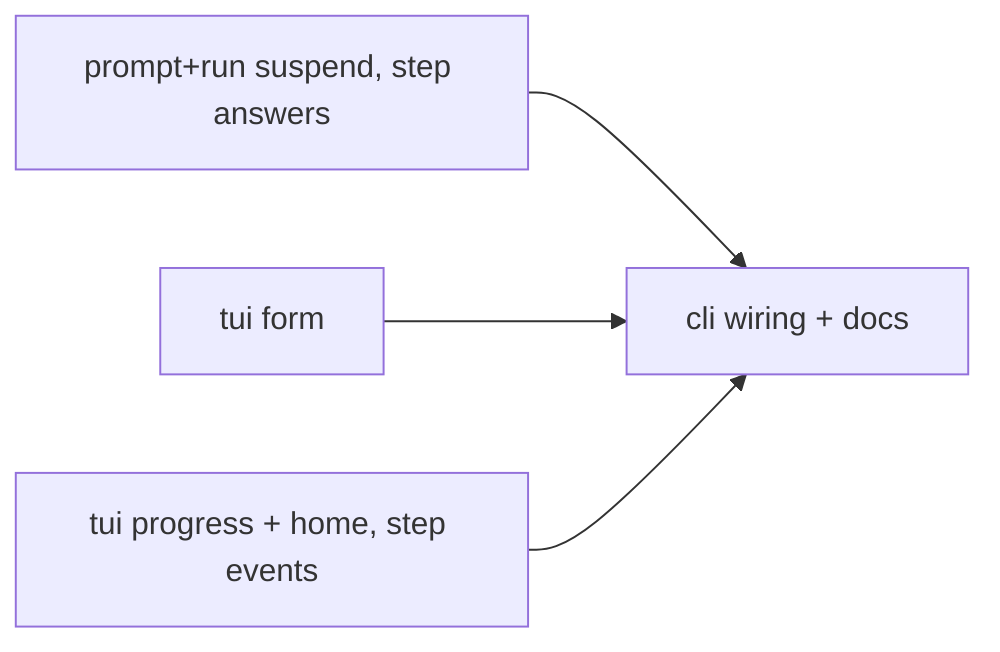

# athome build 3: the TUI

**Spec:** docs/superpowers/specs/2026-11-16-athome-binary-design.md, section "Build 3".
**Branch:** feat/athome-tui. Go 1.27. Tests: isolated `go test -race ./...` (see Global constraints).

Global constraints: no em dash as a sentence break; conventional commits; tests never touch
the real HOME, tmux or terminal; deps added with `go get` (Bubble Tea, huh, lipgloss,
bubbles, x/exp/teatest).

### T1 suspend hooks and form answers in steps
**Owns:** internal/prompt/prompt.go, internal/prompt/*_test.go, internal/run/suspend.go,
internal/run/suspend_test.go, internal/steps/github.go, internal/steps/finish.go, new
internal/steps/prompt_answers_test.go
**Produces:** `Asker.Around func(func())` (when set, each question's print and read run inside it);
`run.Suspending(r Runner, around func(func())) Runner` (Interactive or NeedsSudo cmds run inside
around; others direct); steps honour `Cfg.Data["uploadSshKeys"]`, `Cfg.Data["restoreSecrets"]` and `Cfg.Data["bwBackupSshKey"]` (ssh-bw-backup)
("false" skips without asking and leaves the same follow-up/log lines as a "no"; "true" proceeds without asking).

### T2 the form
**Owns:** internal/tui/form.go, internal/tui/form_test.go, internal/tui/validate.go, internal/tui/validate_test.go, go.mod, go.sum
**Produces:** `tui.Seed{Values map[string]string; Locked map[string]bool; KeyExists bool;
CheckURL, CheckHandle func(context.Context, string) error}`; `tui.RunForm(ctx, in io.Reader, out io.Writer, seed Seed) (map[string]string, error)`,
`tui.ErrQuit`; the returned map holds every spec field key plus sshKeyAction or generateSshKey,
useBitwarden, uploadSshKeys, restoreSecrets, bwBackupSshKey. `tui.ValidEmail(string) bool`.

### T3 progress view, home screen, step events
**Owns:** internal/tui/progress.go, internal/tui/progress_test.go, internal/tui/home.go,
internal/tui/home_test.go, internal/steps/steps.go, internal/steps/steps_test.go
**Produces:** `steps.Event{Name, State string; Err error}` (State: check, skip, apply, done, fail) and
`Env.Events func(steps.Event)` called by `Execute`; `tui.RunProgress(ctx, in, out, env *steps.Env, list []steps.Step, wire func(around func(func()))) (steps.Report, error)`;
`tui.HomeInfo{Version, Commit, Repo, MachineType, Hostname, Handle string; SetUp bool}`;
`tui.RunHome(in, out, info HomeInfo) (string, error)` returning "init" or "quit".

### T4 cli wiring and docs (after T1-T3)
**Owns:** internal/cli/*, docs/install.md, docs/commands.md, docs/how-it-works.md, docs/customizing.md, README.md
Selects TUI vs `--plain`/`ATHOME_PLAIN` vs non-interactive; builds Seed (flag/env locked, file, stored,
defaults), real CheckURL/CheckHandle, merges answers into env.Cfg.Data, runs RunProgress with wire
setting `env.Run = run.Suspending(...)` and `env.Ask.Around`, prints the finish summary; `athome` with no
args on a terminal runs RunHome. Covers acceptance criteria 1, 4, 9, 10 and the cli tests in the spec list.
