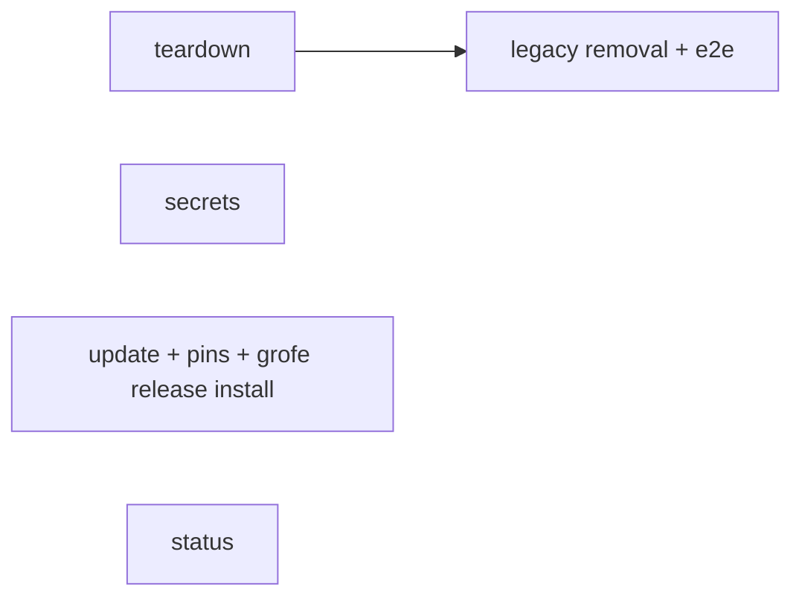

# athome build 4: teardown, secrets, update, status

**Spec:** docs/superpowers/specs/2026-11-16-athome-binary-design.md, section "Build 4".
**Branch:** feat/athome-build4. Each task follows the spec section for its command, writes
its tests first, and updates the docs the spec's "Docs (same PR)" paragraph assigns to it.
Each command lives in its own `internal/cli/<cmd>.go`; the only shared edit is one `case`
line in `cli.Main` and one usage line, made just before commit.

- **B1 teardown:** `athome teardown`, Go tests replacing test/teardown.bats, delete
  scripts/teardown.sh, mise task, docs.
- **B2 secrets:** `athome secrets backup|restore`, one-line wrappers for the old names,
  in-process restore in init (drop `secrets-restore-hint`), docs/secrets.md.
- **B3 update:** `athome update [--to] [-y]`, `steps.Update()`, home/.chezmoidata/pins.toml,
  run_onchange_17/18 read pins, grofe from release with `.sha256`, test/install-grofe.bats.
- **B4 status:** `athome status [--json]`, reads pins.toml (create it if B3 has not yet,
  same content the spec gives).
- **B5 legacy removal (after B1):** delete scripts/bootstrap-legacy.sh, scripts/lib
  leftovers the spec names, installer fallback, e2e runner switch and workflow matrix,
  `athome teardown` in scenario.sh, verify-teardown and status checks, bootstrap.bats.
