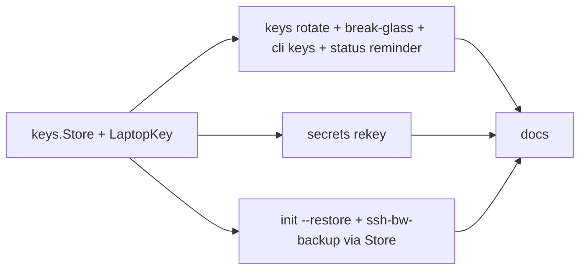

# athome keys build 1: rotation, rekey, restore

**Spec:** docs/superpowers/specs/2026-11-16-keys-and-recovery-design.md, section "Build 1".
**Branch:** feat/athome-keys. Each task writes its tests first and follows the spec's
decisions for its command. `internal/cli/cli.go` changes by two case lines and one usage
line only (build 3, the TUI, is in flight and edits it too); they are made last, by K1.

| Task | Owns |
| --- | --- |
| K0 store | `internal/keys/store.go`, `internal/keys/store_test.go`, `internal/keys/fakebw_test.go` |
| K1 rotate | `internal/keys/{rotate,state,github,breakglass,box}.go` and tests, `internal/cli/keys.go`, `internal/cli/keys_test.go`, `internal/status/keys.go` and test, `internal/status/status.go` (one field), `internal/cli/status.go` (one line), `internal/cli/cli.go` (case and usage lines) |
| K2 rekey | `internal/secrets/rekey.go`, `internal/secrets/rekey_test.go`, `internal/cli/secrets.go`, `internal/cli/secrets_test.go`, `internal/cli/cli_test.go` (the `secrets rekey` expectation) |
| K3 restore | `internal/steps/restore.go`, `internal/steps/restore_test.go`, `internal/steps/sshkey.go` (`skStoreInRBW` only), `internal/steps/sshkey_bitwarden_test.go`, `internal/cli/restore.go`, `internal/cli/restore_test.go` |
| K4 docs | `docs/secrets.md`, `docs/commands.md`, `docs/install.md`, `README.md` |
