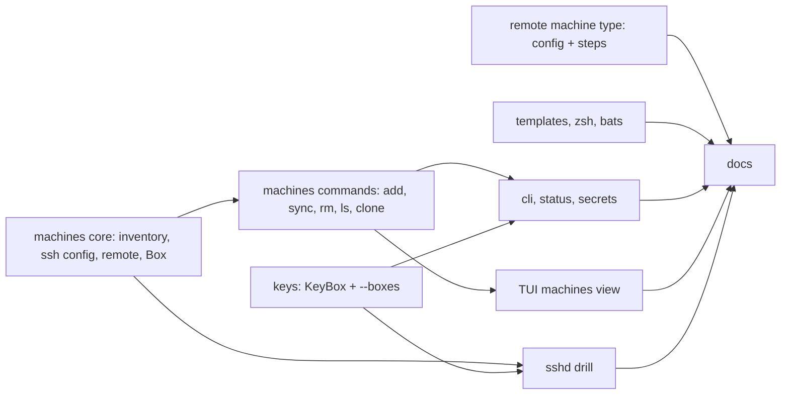

# athome remote machines

**Spec:** docs/superpowers/specs/2026-11-16-remote-machines-design.md, section "Build".
**Branch:** feat/athome-remote-machines. Every task writes its tests first and follows the
spec's Build decisions. grofe is faked in every test; the grofe CLI is the one in
termage/grofe#52 (`grofe machine add <name> <target>`, `grofe machine ls`,
`grofe machine rm <name>`, `grofe -r <host> [command...]`). Tests never touch the real
HOME, ssh config, `~/.ssh`, a real host, Bitwarden or GitHub.



| Task | Owns |
| --- | --- |
| R1 core | `internal/machines/{inventory,sshconfig,pending,projects,remote,box}.go` and their tests, `internal/machines/testdata/`, `test/ssh-config.bats` |
| R2 commands | `internal/machines/{add,bootstrap,sync,rm,clone,ls,github}.go` and their tests |
| R3 remote type | `internal/config/config.go`, `internal/config/config_test.go` (new cases), `internal/steps/{data,baseline,finish,sshkey}.go` (remote branches only), `internal/steps/remote_test.go` |
| R4 templates | `home/**` (see the spec's Templates decision), `test/templates.bats`, `test/ssh-nudge.bats`, `.github/workflows/lint.yml` (chezmoi and zsh in the bats job) |
| R5 keys | `internal/keys/box.go`, `internal/keys/rotate.go`, new `internal/keys/boxrotate.go` and `boxrotate_test.go` |
| R6 cli | `internal/cli/{machine,project}.go` and tests, `internal/cli/cli.go` (two case lines, two usage lines, the `keys.Inventory` wiring), `internal/cli/cli_test.go` (usage expectation), `internal/status/{status,machines}.go` and test, `internal/cli/status.go` (the warning lines), `internal/secrets/secrets.go` (one mirrored path) and its test |
| R7 TUI | `internal/tui/{home,machines}.go` and tests, `internal/cli/tui.go` (home dispatch), `internal/cli/machines_tui.go` and test |
| R8 sshd | `test/sshd/`, `internal/machines/sshd_test.go`, `.github/workflows/sshd.yml` |
| R9 docs | `docs/remote-machines.md`, `docs/spatial-model.md`, `docs/how-it-works.md`, `docs/customizing.md`, `docs/commands.md`, `docs/secrets.md`, `README.md` |

## Contracts

`internal/machines` (R1):

```go
type Machine struct {
    Name          string   `toml:"-"`
    Scope         string   `toml:"scope"`
    Target        string   `toml:"target"`
    User          string   `toml:"user"`
    Jump          string   `toml:"jump"`
    Port          int      `toml:"port"`
    Athome        string   `toml:"athome"`
    ForwardAgent  bool     `toml:"forward_agent"`
    GitHubAccount string   `toml:"github_account"`
    Repos         []string `toml:"repos"`
    Home          string   `toml:"home"`
    Hostname      string   `toml:"hostname"`
}
func (m Machine) Validate() error          // the Build's character sets; names machine and field
func (m Machine) Context() string          // "work" for "work/acme"
func Path(home string) string              // ~/.config/athome/machines.toml
func Load(home string) ([]Machine, error)  // validated, name order; missing file = none
func Save(home string, ms []Machine) error // 0600 via temp+rename, dir 0700; then Refresh
func Refresh(home, laptopKeyFile string) error // ssh config + remote-projects from inventory + pendings
func CheckLocalScope(home, scope string) error
func ScopeWarnings(home string, ms []Machine) []string
func SSHConfig(ms []Machine, laptopKeyFile string) string
func SSHDir(home string) string            // ~/.ssh/athome
func KnownHosts(home string) string        // ~/.ssh/athome/known_hosts
func CheckInclude(home string) error
func LoadPending(home, name string) (*Machine, error) // nil, nil when absent
func SavePending(home string, m Machine) error
func RemovePending(home, name string) error
func ProjectCommand(m Machine, repo string) []string
func WriteRemoteProjects(home string, ms []Machine) error

type Remote struct { Run run.Runner; Home, Host string } // Host: laptop short hostname
func (r Remote) Exec(ctx context.Context, name, script, stdin string, args ...string) (run.Result, error)
func (r Remote) Interactive(ctx context.Context, name, script string, args ...string) (run.Result, error)
func (r Remote) LoginCheck(ctx context.Context, m Machine, key string) error
func ShQuote(s string) string

type Box struct{ /* Remote + Machine */ }
func NewBox(r Remote, m Machine) *Box       // implements keys.Box and keys.KeyBox
func KeysInventory(home string, r run.Runner, host string) ([]keys.Box, error)
```

`internal/keys` (R5): `KeyBox` embeds `Box` and adds `GitHubAccount() string`,
`CurrentPub(ctx) (string, error)`, `NewKey(ctx) (string, error)`,
`CheckGitHub(ctx, rotating bool) error`, `PromoteKey(ctx, newPub string) error`.

`internal/machines` (R2):

```go
type Deps struct {
    Run     run.Runner
    Home    string
    Host    string        // laptop short hostname
    Version string        // running athome version
    Out     io.Writer
    Ask     *prompt.Asker // nil: never prompt
    Backup  func(ctx context.Context) error // athome secrets backup, in process
}
func AddSteps(d Deps, m *Machine) []steps.Step
func Add(ctx context.Context, d Deps, m Machine) error
func Sync(ctx context.Context, d Deps, name string, all bool) error
func Remove(ctx context.Context, d Deps, name string, force bool) error
func Clone(ctx context.Context, d Deps, repo, machine string) error
func List(home string, w io.Writer) error
func BootstrapTOML(data map[string]any, m Machine, timezone, locale string) string
```
